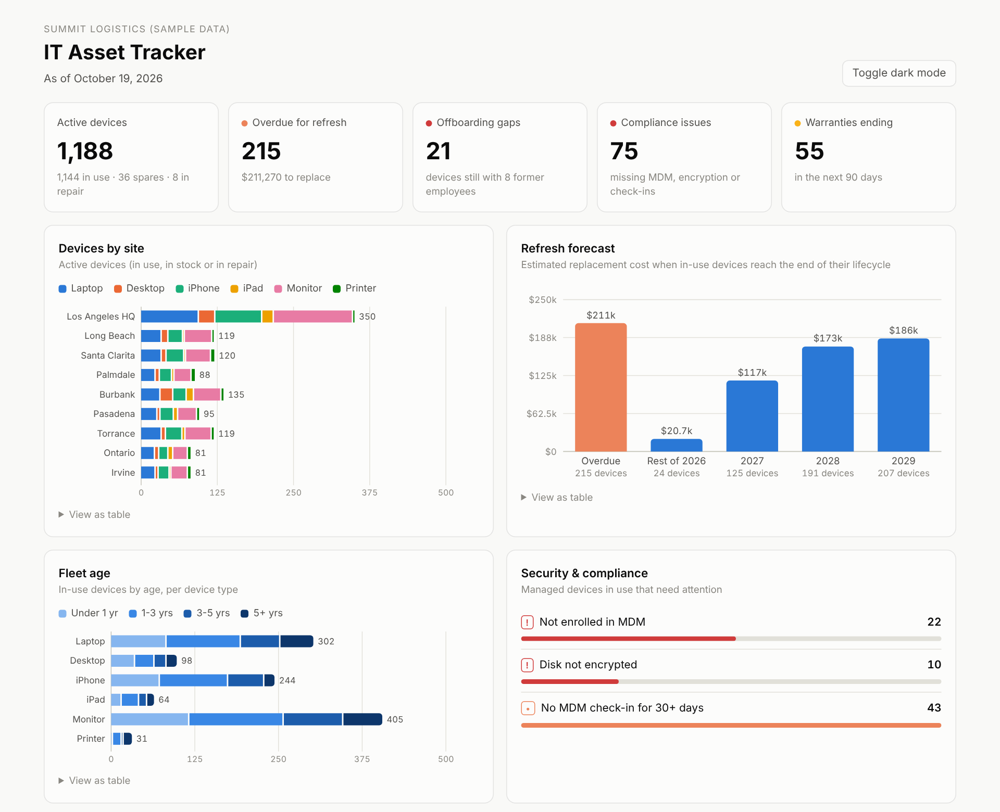

# IT Asset Tracker

A SQLite database, SQL reports and a dashboard for tracking a company's laptops, desktops, phones, tablets, monitors and printers: who has each device, where it is, when it's due for replacement, and which devices are a security or offboarding risk.

**[View the live dashboard](https://raulit-eng.github.io/it-asset-tracker/)**



## Why I built this

I've supported 400 users across 9 sites, run a 1,500-iPhone refresh across international business units, and managed worldwide IT procurement. In every one of those jobs, the hard questions were the same:

- Which devices are past their replacement date, and what will the next refresh cost?
- Who still has a company laptop after leaving?
- Which devices dropped out of Jamf or Intune, or aren't encrypted?
- Which warranties are about to run out?

This project answers all four from one database. It uses a fake company, **Summit Logistics**, with about 400 employees and 1,250 devices across 9 Southern California sites. All names and devices are randomly generated.

## What the dashboard shows

| Section | What it tells you |
|---|---|
| **Headline numbers** | Active devices, refresh backlog and cost, offboarding gaps, compliance issues, expiring warranties |
| **Devices by site** | How many of each device type every site has |
| **Refresh forecast** | Replacement cost by year, based on each device type's lifecycle |
| **Fleet age** | How old the in-use fleet is, per device type |
| **Security & compliance** | Devices missing MDM enrollment, disk encryption, or a check-in in the last 30 days |
| **Action list** | Searchable to-do lists: devices to recover, fix, replace, or repair under warranty |

On the sample data it finds **21 devices still held by 8 former employees**, **75 compliance issues**, and **215 devices overdue for refresh** ($211k to replace).

## How it works

```
generate_sample_data.py  ->  data/assets.db  ->  sql/reports.sql  ->  build_dashboard.py  ->  docs/index.html
     (fake company)          (SQLite)          (9 SQL reports)        (runs the reports)       (the dashboard)
```

- **`sql/schema.sql`** defines the tables: sites, employees, assets, asset history, and a refresh policy with each device type's lifecycle and replacement cost.
- **`sql/reports.sql`** holds every report as plain SQL. The command-line report runner and the dashboard both read this file, so there's one source of truth.
- **`refresh_policy` is a table, not hard-coded.** Change a laptop's lifecycle from 4 years to 5 and every refresh number updates.
- **The dashboard is one self-contained HTML file** with no external libraries, so it works offline and publishes free on GitHub Pages.

## How to run it

You need Python 3.10 or newer. The tool itself only uses Python's standard library.

```bash
python generate_sample_data.py   # builds data/assets.db
python run_reports.py            # prints every report
python build_dashboard.py        # writes docs/index.html - open it in your browser
```

More report options:

```bash
python run_reports.py --list            # list the reports
python run_reports.py offboarding_gaps  # run one report
python run_reports.py --csv             # also save every report to output/ as CSV
```

To run the tests: `pip install -r requirements.txt`, then `python -m pytest`.

## The reports

| Report | Question it answers |
|---|---|
| `assets_by_site` | What does each site have? |
| `refresh_due` | Which in-use devices are past their lifecycle? |
| `refresh_forecast` | What will replacements cost each year? |
| `warranty_expiring` | Which warranties end in the next 90 days? |
| `compliance_issues` | Which devices are missing MDM, encryption, or recent check-ins? |
| `offboarding_gaps` | Which devices are still assigned to people who left? |
| `fleet_age` | How old is the fleet? |
| `spend_by_year` | What did we spend on hardware each year? |
| `asset_history` | What's happened to a specific device? |

## Skills shown

- Relational database design (SQLite): keys, constraints, a policy table, and an event history
- SQL reporting with joins, date math, CASE logic and grouping
- IT asset lifecycle management: refresh planning, warranties, offboarding, MDM and encryption compliance
- Python data tooling and a dependency-free HTML dashboard with light and dark modes

## Author

**Raul Astorga** – IT Support & Systems Consultant
